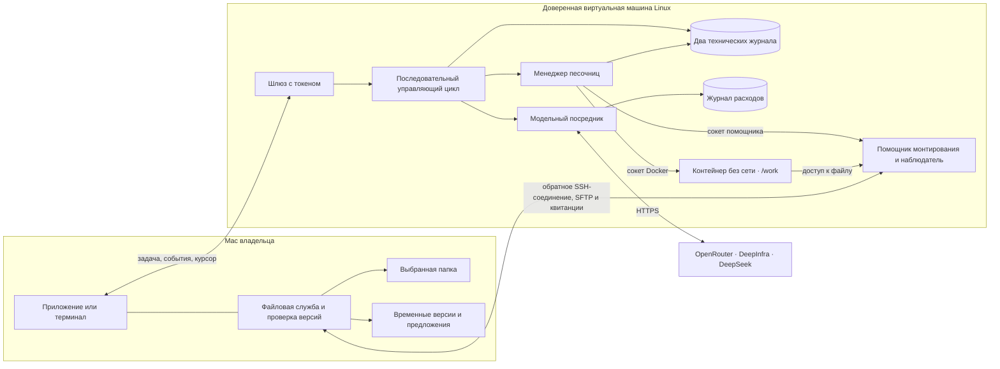

# Демонстрация рабочей папки

Выберите на Mac каталог проекта. Графический клиент показывает события, ответ и решения о записи. Временное отключение от шлюза сохраняет позицию чтения событий в открытом клиенте. Кнопка «Завершить сеанс» закрывает файловое подключение. Оригиналы остаются на Mac.

## Как проходит запрос



Вызов `RunCommand` получает код выхода и потоки вывода из контейнера. Помощник сопоставляет фактически переданные файловые операции с подтверждением на Mac. При конфликте клиент показывает отдельную версию, а управляющий цикл передаёт модели результат и уведомление о сохранении. При потере подтверждения фиксируется неизвестный исход записи. В журнале после закрытия остаются номера, время и состояния. [Код цикла](../../runtime/harness.py) · [Файловая служба](../../client/mount.py) · [Схема компонентов на первом слайде](slides.html#architecture).

## Подготовка стенда

Нужны macOS, инструменты разработчика Apple с компилятором Swift, Colima, Docker Compose, Python 3.12 и uv. Следующие команды создают отдельную виртуальную машину Linux без общих папок. Они предназначены для нового профиля. При повторном запуске используйте тот же профиль и существующие тома.

```sh
uv sync --frozen
uv pip install -r requirements-desktop.txt
colima start --profile itmo-checkpoint2 --mount none --activate=false --cpu 4 --memory 5 --disk 18
colima ssh --profile itmo-checkpoint2 -- sh < prototypes/mounting/prepare_linux.sh
.venv/bin/python scripts/prepare_colima_workspace.py --profile itmo-checkpoint2 --output .local/checkpoint2
export DOCKER_CONTEXT=colima-itmo-checkpoint2 COMPOSE_PROJECT_NAME=itmo-cp2 GATEWAY_PORT=18124
export RUNTIME_URL=http://127.0.0.1:18124
source .local/checkpoint2/mount.env
sh scripts/compose.sh -f compose.yaml -f compose.offline.yaml up -d --build --wait
```

Подготовка получает зависимости из сети. Последняя команда включает имитацию модели и убирает внешнюю сеть у модельного посредника. Помощник работает внутри виртуальной машины. Приватный ключ для монтирования хранится на стороне Linux. Настройки с адресом и открытыми ключами клиента находятся в исключённом из Git каталоге `.local/`.

## Показ в окне или в терминале

Скопируйте учебные файлы в новую рабочую папку, чтобы результат было видно в Finder. Имитация распознаёт задания из учебного набора по маркеру `[replay:B1.1]` в тексте задачи. Для работы с реальной моделью действуют отдельные настройки поставщика и бюджета.

```sh
DEMO_DIR=$(mktemp -d)
cp -R baf/B1-read/B1.1-service-port/fixture/. "$DEMO_DIR"
.venv/bin/python -m client.desktop
```

В окне введите адрес из `RUNTIME_URL`, выберите созданный каталог и нажмите «Подключить». Отправьте указанный ниже запрос. Откройте появившийся `answer.txt` на Mac. Ожидаемое значение — `8137`. В терминале тот же сценарий выполняется через тот же клиент сессии.

```sh
.venv/bin/python -m client.cli --folder "$DEMO_DIR" \
  '[replay:B1.1] Read the service port from config/app.yaml and write only the number to answer.txt.'
```

Режим «Только чтение» или параметр `--read-only` запрещает запись. Для обычного проекта изменение существующего файла сохраняется отдельным предложением, когда безопасность замены нельзя подтвердить. Кнопка «Сохранить предложенную версию» копирует его под новым именем до окончания сеанса. В терминале используйте `--save-proposals DIR`. Автоматические проверки существующих файлов и книг выполняются в специально созданных синтетических папках с согласованной записью через системный координатор macOS.

## Сборка приложения

```sh
uv pip install pip==26.3 Nuitka==2.7.11 ordered-set==4.1.0 zstandard==0.24.0
.venv/bin/python scripts/build_desktop.py
dist/Workspace.app/Contents/MacOS/Workspace
```

Приложение также открывается в Finder. Нажмите «Открыть настройки подключения» и выберите `.local/checkpoint2/connection.json`, созданный при подготовке стенда. Для доступа к скрытой папке в окне выбора пути используйте Command+Shift+G. При запуске из терминала подходят настройки из `mount.env`. Сборка включает Qt и программный код клиента. В репозитории находятся исходники и команда воспроизведения. [Графический клиент](../../client/desktop.py) · [Настройка модели](../reference/model.md) · [Сравнение вариантов монтирования](../adr/0003-mounting.md).

## Проверки

```sh
sh scripts/check.sh
.venv/bin/python -m baf.run --mode mock --workspace mounted --task B1.1 --task B9.1
PYTHONPATH=. .venv/bin/python scripts/measure_mounted.py --docker-context colima-itmo-checkpoint2 \
  --project itmo-cp2 --url "$RUNTIME_URL" --output results/measurements.json
```

Первая команда проверяет протоколы, клиент, изоляцию, 35 проверяющих программ и девять демонстрационных задач. Вторая проводит два примера через настоящий файловый канал. Третья сравнивает операции монтирования и снимка исходных файлов. [Измеренные результаты](../../evidence/checkpoint-2/README.md) · [Полный список вопросов](questions.md).
